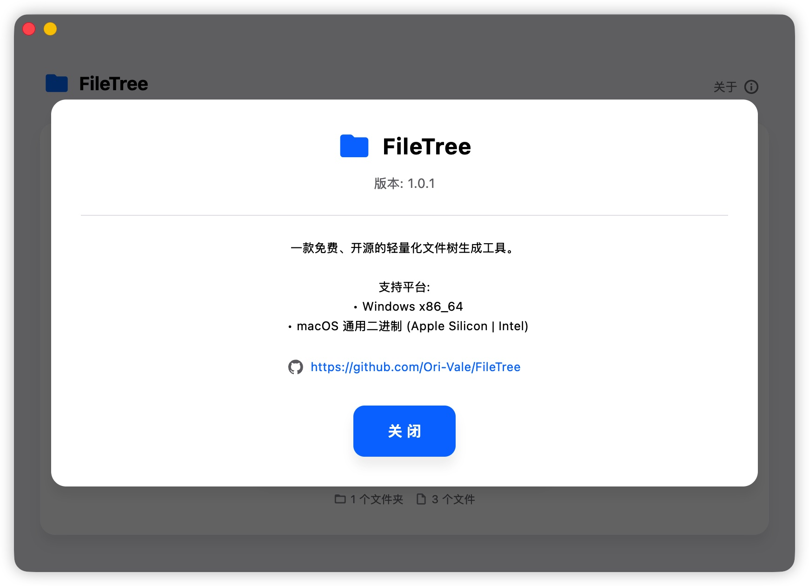

# FileTree

一款免费、开源的轻量化文件树生成工具。

## 功能特性

- 🖥️ 图形界面操作，无需命令行
- 📁 递归扫描目录结构
- 📊 实时显示文件夹和文件统计
- 💾 导出为多种格式：HTML、Markdown、Text
- ⚡ 快速生成，支持大目录扫描
- 🎨 精美的 Ori Vale 视觉风格 (类 Sequoia 和 Tahoe)

## 截图




## 支持格式

| 格式 | 说明 |
|------|------|
| HTML | 带折叠功能的树形结构页面 |
| Markdown | 适合嵌入文档的格式 |
| Text | 纯文本树形结构 |

## 支持平台

- Windows x86_64
- macOS 通用二进制 (Apple Silicon | Intel)

## 快速开始

### 安装

从 [GitHub Releases](https://github.com/Ori-Vale/FileTree/releases) 下载对应平台的安装包。

### 从源码构建

```bash
# 克隆仓库
git clone https://github.com/Ori-Vale/FileTree.git
cd FileTree

# 安装依赖
flutter pub get

# 运行
flutter run -d macos   # macOS
flutter run -d windows # Windows

# 构建发布版本
flutter build macos    # macOS
flutter build windows  # Windows
```

## 使用方法

1. 启动应用
2. 点击「选择」按钮，选择需要生成树形结构的路径
3. 应用会自动扫描并显示目录结构
4. 选择需要的输出格式（HTML、Markdown、Text）
5. 点击「选择」按钮，选择文件树导出路径
6. 点击「导出树形结构」按钮，导出文件

## 技术栈

- **框架：** Flutter 3.0+
- **状态管理：** Provider
- **语言：** Dart 3.0+
- **设计：** Ori Vale 家族化视觉组件 (类 Sequoia 和 Tahoe)

## 贡献

欢迎提交 Issue 和 Pull Request！

1. Fork 本仓库
2. 创建功能分支 (`git checkout -b feature/AmazingFeature`)
3. 提交更改 (`git commit -m 'Add some AmazingFeature'`)
4. 推送到分支 (`git push origin feature/AmazingFeature`)
5. 打开 Pull Request

## 许可证

本项目采用 MIT 许可证 - 详见 [LICENSE](LICENSE) 文件

## 作者

**Ori Vale**
- GitHub: [@Ori-Vale](https://github.com/Ori-Vale)
- Email: orivale@foxmail.com
